[reading through this](https://www.scratchapixel.com/lessons/3d-basic-rendering/perspective-and-orthographic-projection-matrix//building-basic-perspective-projection-matrix.html)

## perspective projection

TODO: refresh:

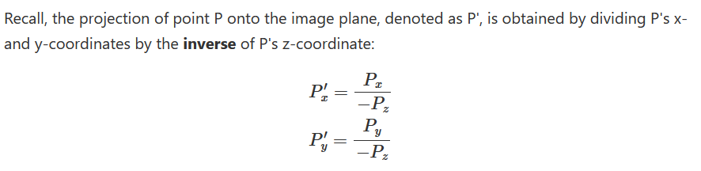

camera is positive x towards you

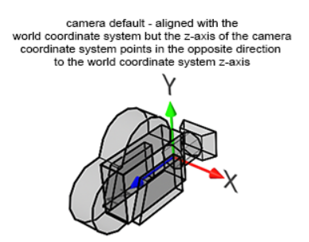

set point P' to:

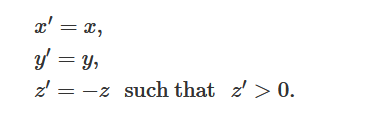
+ reason z is neg: such that everything you see is in negative z direction, so that's what you're PROJECTING towards so to speak

then (remember above point projection pic of P/p_z)

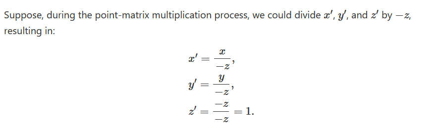
+ ignore z' for a minute

to adjust z' to 0 when at the near clip plan, and 1 at the far clip plane (remember z' is actually -z -> so would adjust to -1)

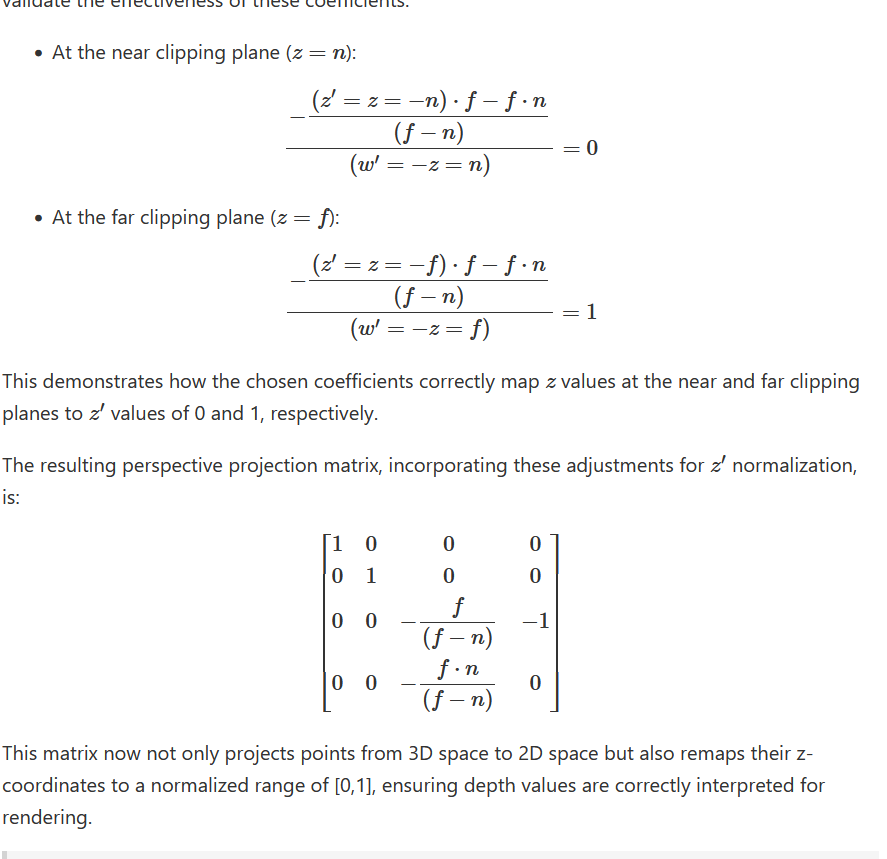
+ n -> distance to the near clipping plane
+ f -> distance to the far clipping plane
+ those coefficients are chose specifically to achieve that z' is 0 at the near clip plane and 1 at the far clip plane

field of view must also be accounted for:
+ fov controls how much of the scene is seen
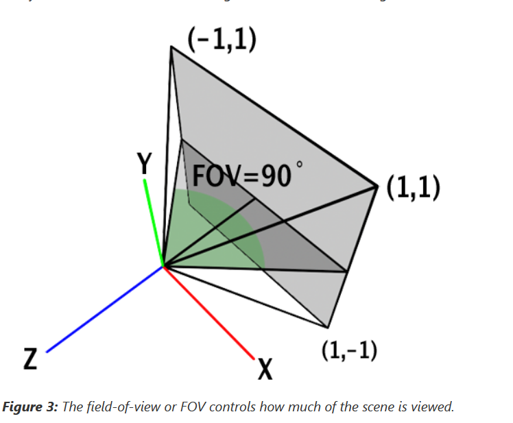
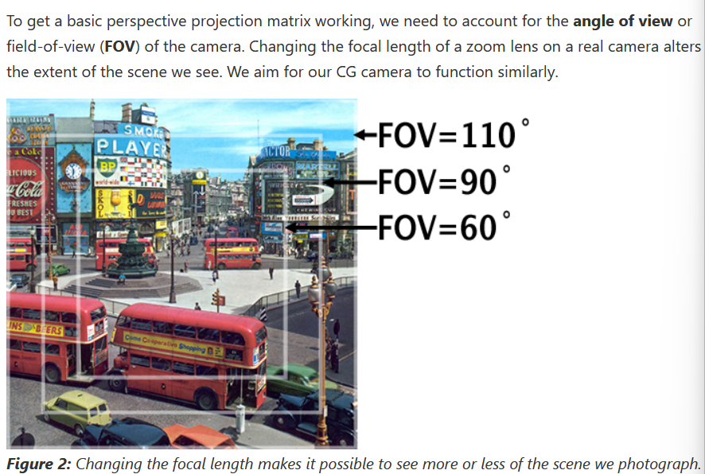

"Remember from chapter 1, the goal of the perspective projection matrix is to project a point onto the screen and remap their coordinates to the range [-1,1] (or to NDC space)."

we keep the screen window size fixed, so instead adjust the projected coordinates by scaling them up or down

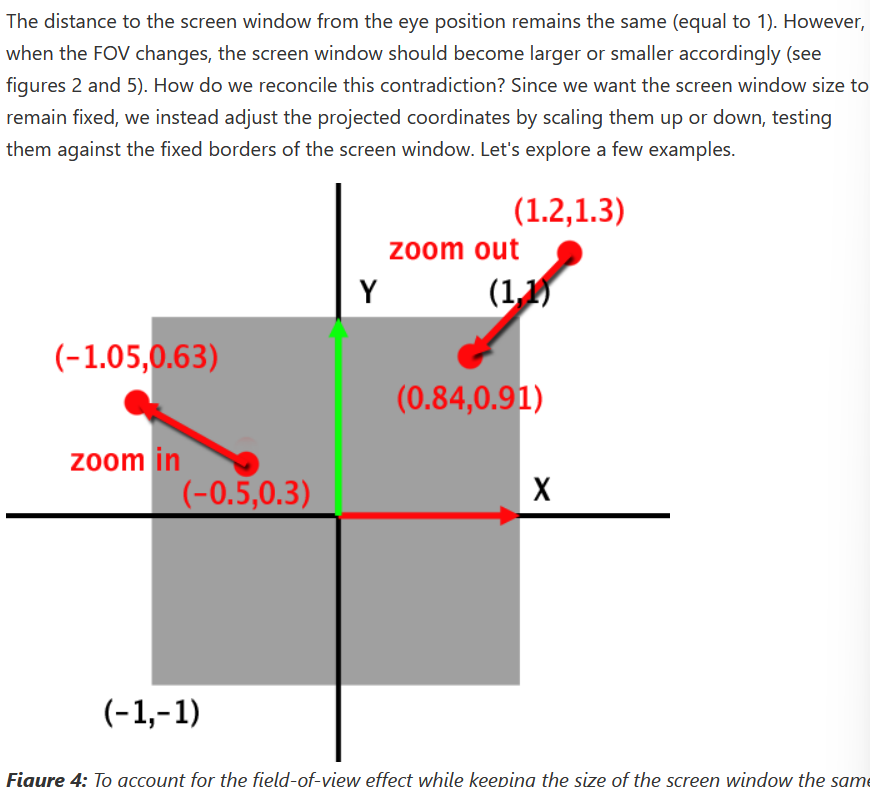
+ multiply some points by 0.7 to "scale them down", effectively bringing them into the field of view
  + zooming out means scaling points down
  + zooming in mean scaling points up

the FOV angle is not utilized directly, but instead the tangent of the angle.
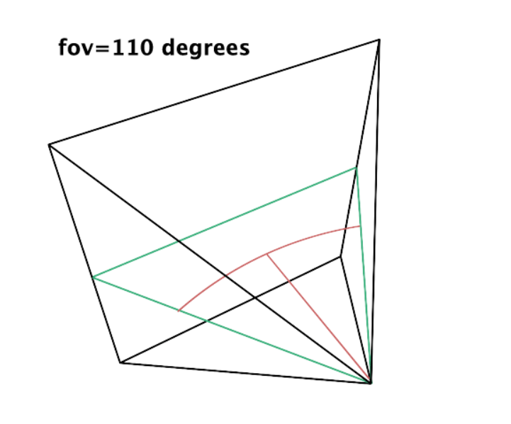
+ to get the scaling factor for zooming, the half of the FOV angle is used (90 -> 45); point is to focus mathematically on the right triangle that makes within the viewing cone
+ essentially tan(theta/2) > 1 when theta > 90
  + tan(theta/2) < 1 when theta < 90
+ when we increase theta we want to scale things down, and vice versa with decrease theta
+ so we use the reciprocal:

final: 

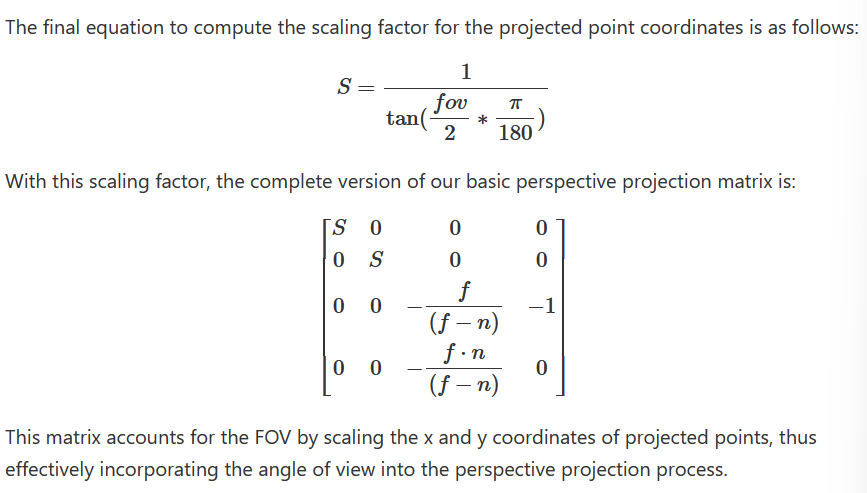

```C
void setProjectionMatrix(const float &angleOfView, const float &near, const float &far, Matrix44f &M) 
{ 
    // set the basic projection matrix
    float scale = 1 / tan(angleOfView * 0.5 * M_PI / 180); 
    M[0][0] = scale;  // scale the x coordinates of the projected point 
    M[1][1] = scale;  // scale the y coordinates of the projected point 
    M[2][2] = -far / (far - near);  // used to remap z to [0,1] 
    M[3][2] = -far * near / (far - near);  // used to remap z [0,1] 
    M[2][3] = -1;  // set w = -z 
    M[3][3] = 0; 
} 
```

## orthographic projection

[helpful](https://www.scratchapixel.com/lessons/3d-basic-rendering/perspective-and-orthographic-projection-matrix//orthographic-projection-matrix.html)

why? -- remap all coordinates within a specific 3d space bounding box to the **"canonical viewing volume"**
+ "By iterating over each object in the scene, calculating their bounding boxes, and adjusting the dimensions of the global bounding box to include all these volumes, you establish the scene's bounding box."
  + "The orthographic matrix then aims to remap this box to a canonical view volume, defined by minimum and maximum extents of (-1, -1, -1) and (1, 1, 1) (or (-1, -1, 0) and (1, 1, 1), depending on the convention used)"
    + x and y are mapped from their original range -> [-1, 1] and z -> [-1, 1] or [0, 1]

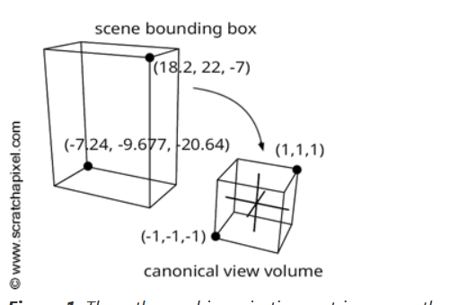

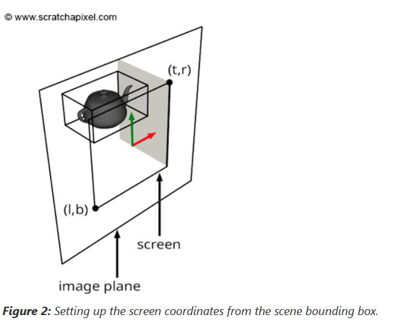
+ to get the transformation for x you get l <= x <= r and solve it to: -1 <= x' <= 1
  + same thing for y but t <= b <= t

hence the transformation for x and y yields:

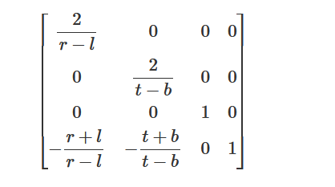

+ we do the same thing for z really, but using n and f as defined above in perspective
  + "Don't forget that because we use a right-hand coordinate system, the z-coordinates of all points visible to the camera are negative, which is why we use instead of ."

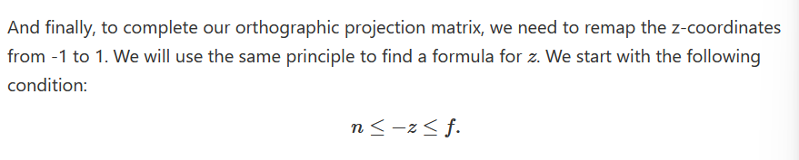


final: 

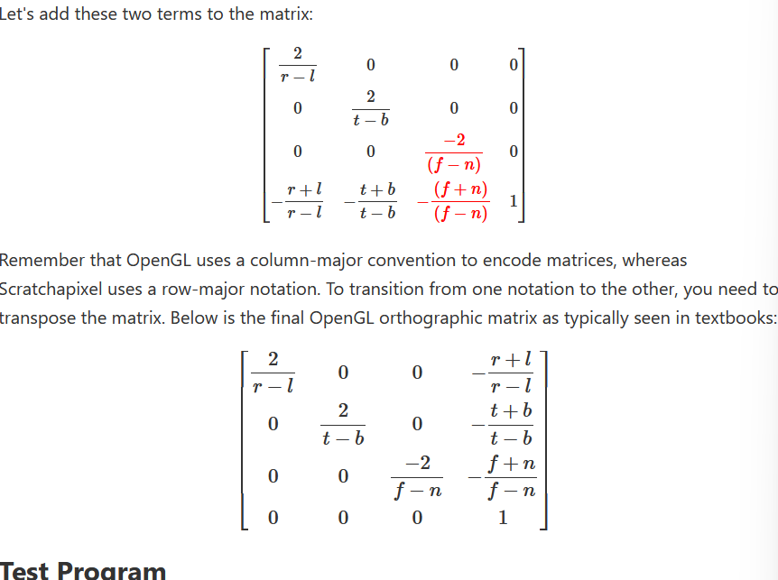